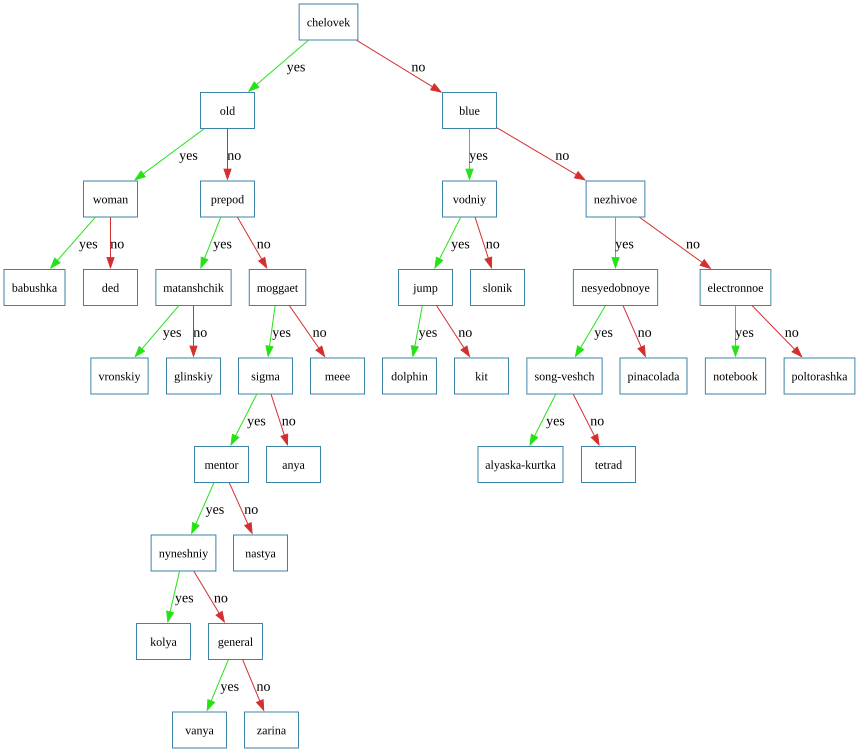

# **Mashka's АКИНАТОР**
Перед вами реализация авторского акинатора на языке C на основе бинарного дерева с несколькими режимами работы и возможностью пополнения базы.

# **Режимы работы**
* Игра в терминале: пользователь отвечает на вопросы да или нет и получает предположение от акинатора, кого же мог загадать пользователь. При неверном ответе пользователь может посодействовать развитию базы и вписать верный ответ и его отличительную особенность.

* Игра в графичсеком окне: пользователь попадает в графическое окно и играет в того же акинатора, что и в терминале. Подробнее о фичах графической игры будет написнао далее.

* Режим определения: пользователь вводит название элемента, находящегося в базе ([пример базы](data/tree_data.txt)) и получает определение, исходя из пути от корня дерева до этого элемента.

* Режим сравнения: работает похожим на опредение образом. Пользователь вводит два слова из базы и получает схожие и отличительные черты этих элементов, исходя из пути от корня дерева до этого элемента.

# **Запуск программы**

Необходимы компилятор C++, [Graphviz](https://graphviz.org/) и [Raylib](https://www.raylib.com/).
При сборке введите в терминал:

```bash
 g++ src/main.cpp src/tree_funcs.cpp src/game.cpp -Isrc -o game.exe -o a.exe -lraylib -lwinmm -lgdi32
 .\game.exe
```

# **"Внутрянка" для желающих разобраться в работе акинатора и/или использовать функции из этого набора в своих целях**
Акинатор написан на основе бинарного дерева. Почему? Так как ответ на любой вопрос задумывался "да" или "нет", у каждого узла с вопросом оказывались две ветки дальнейшего развития. А бинарное дерево, в свою очередь, как раз - структура данных, в которой каждый узел имеет не более двух "детей".

Для удобства работы с бинарными деревьями было написано следующее:

**Структуры**
```cpp
структура, хранящая информацию об узле
struct node_t {
    const char* text;
    node_t*     positive;
    node_t*     negative;
    node_t*     parent;
};

структура, хранящая информацию о дереве
struct tree_t {
    node_t* root;
    node_t* current_node;
    size_t  size_of_tree;
};
```

**Функции**
```cpp
функция, задающая корень дерева
tree_error_t tree_ctor        (tree_t* tree, const char* value_of_root);

функция, отлавливающая ошибки при работе с деревом
int tree_verify               (tree_t* tree, const char* function_name, int line);

функция, создающая узел
node_t* create_node           (node_t* node);

функция, задающая "детей"
void create_children          (node_t* node);

функция, печатающая в достаточно удобном виде своеобразный дамп дерева ()
void print_tree               (node_t* node, FILE* out, int* rank);

функция, дампающая узел дерева
void dump_node                (const node_t* node, FILE* out, size_t* id);

функция, дампающая дерево целиком
void dump_tree                (const tree_t* tree, const char* filename);

функция, уничтожающая дерево и освобождающая после него память
void destroy_tree             (node_t* node);

не настолько универсальная, но полезная в некоторых случаях функция, проверяющая, что у каждого узла двое детей 
tree_error_t check_children   (node_t* node, int* n);
```

**Специальный ассерт**
```cpp
советую ставить после создания/изменения дерева для отслеживания некорректности
TREE_ASSERT(tree_t* tree); 
```

# **Графическая игра**
Графический режим создан с помощью библиотеки [Raylib](https://www.raylib.com/). В ходе работы были созданы несколько полезных для любых графических игр *структур:*
```cpp
структура мышки с различными ее состояниями
struct mouse_t {
    Vector2 mouse_pos;  // положение
    bool is_down;       // зажата ли 
    bool is_pressed;    // нажата ли
    bool is_released;   // отпустили ли, те верно, когда игрок вот только нажал
};

структура кнопки с различными цветами для разных "состояний"
struct button_t {
    Rectangle rect;          // задаем координаты и размер
    const char* text;        // текст на кнопке
    Color base_color;        // цвет в обычном состоянии
    Color hovered_color;     // цвет, когда наведена мышка
    Color pressed_color;     // цвет, когда нажата 
    bool  is_down_on_button; // наведена ли мышка
};

структура звукового слайдера, учитывающая взаимодействия пользователя с ним
struct slider_t {
    Rectangle slider_track_rect; // дорожка ползунка
    float value;                 // значение громкости
    bool  is_dragging;           // тянет ли юзер ползунок
};

структура для создания окон, в которые можно вводить текст
struct text_input_t {
    char buffer[MAX_INPUT_LEN + 1];
    int  length;
    Rectangle text_rect;
    bool active;
};
```

*и функций:*
```cpp
функция для проверки, нажата ли кнопка
bool update_button           (button_t* btn, Vector2 mouse_pos, bool is_mouse_released);

функция для отрисовки кнопки в разных цветах в зависимости от взаимодействий мышки с ней
void draw_button             (button_t* btn, Vector2 mouse_pos, bool is_mouse_down, int shrift);

функция отрисовки звукового слайдера для регулирования громкости звуков
float update_and_draw_slider (slider_t* slider, Vector2 mouse_pos, bool is_mouse_down, bool is_mouse_released);

функция обновления текста в соответствующей структуре
void update_text_input       (text_input_t* text); 

функция, проверяющая закончилась ли печать
bool input_text_submitted    (void);

функция, отрисовывающая текст, который вводит пользователь
void draw_input_text         (text_input_t* text);

фунцкия, сообщающая в структуру текста об удалении букв
void text_input_clear        (text_input_t* text);
```
*Фичи:* из интересного, конечно, звуковой слайдер, позволяющий прямо в игре изменять громкость музыки, 3 состояния кнопки (обычное, при наведении мыши, при нажатии мышкой),
возможность начать сначала и выйти в главное меню в любой момент игры, работа с вводимым текстом и в целом оформление окон для ввода этого текста.

# **Дамп базы**
Для удобства просмотра базы, после каждого ее пополнения программа обновляет .dot файл, при запуске которого появится графический дамп, в качестве примера покажу нынешнее состояние созданной мною базы:

Дамп реализован с помощью [Graphviz](https://graphviz.org/)

# **Итог**

Проект был написан в учебных и развлекательных целях при изучении языка C и графики. При нахождение багов просьба писать на моей страничке в разделе [Issues](https://github.com/molushkax/akinator/issues).
Приятной игры)